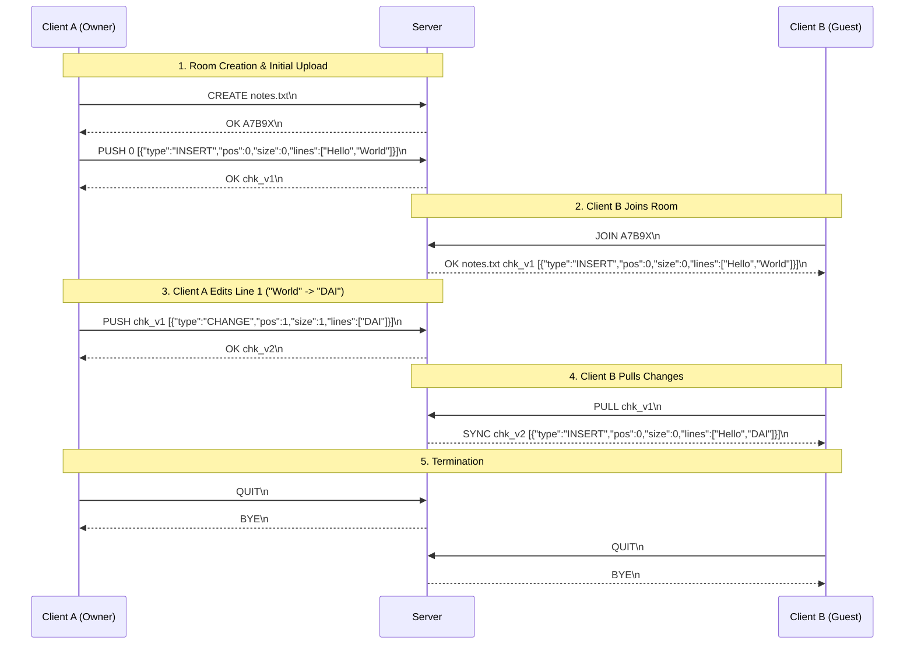
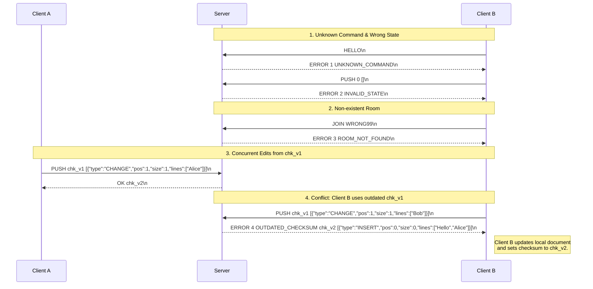

# NNLSP - NNLS Not Live Share Protocol (v1)

## Section 1: Overview

The NNLSP is a text-based, client-driven request-response application protocol that allows multiple clients to collaboratively edit and synchronize a text document hosted in a virtual room on a central server (**Collaborative Diff Synchronization Protocol**).

Instead of transmitting entire files upon each edit, NNLSP exchanges incremental line diffs (`INSERT`, `DELETE`, `CHANGE`) based on `java-diff-utils`. Document integrity and concurrency control are enforced via **SHA-256 checksums**:
1. A client creates a room for a file (initial server checksum is `"0"`) and uploads the content.
2. Other clients join using a unique 5-character room code and retrieve the current document state.
3. When pushing edits, a client supplies the checksum of its base version (`prevChecksum`).
4. If `prevChecksum` matches the server checksum, the patch is applied and a new checksum is generated.
5. If `prevChecksum` does not match (concurrent edit), the server rejects the patch with `ERROR 4 OUTDATED_CHECKSUM` and sends the up-to-date document state for local reconciliation.

---

## Section 2: Transport Protocol

* **Transport Protocol:** TCP.
* **Justification:** Incremental diff patching requires strict in-order and lossless delivery; any lost or reordered diff corrupts the document. TCP also provides reliable connection lifecycle tracking (detecting client disconnection to clean up session resources).
* **Default Port:** `4242`.
* **Encoding:** `UTF-8`, because `java-diff-utils` is text based (binary is out of the scope of this project).
* **Framing (End of Message):** Every request and response is a single line terminated by a Line Feed (`\n`).
  * Parameters are space-separated.
  * JSON payloads **must be compact (single-line, unformatted)** and **must not contain any raw newline or carriage return characters** (`\n` or `\r`). Each line of the synchronized file is represented as a separate string element within the `lines` array. So, the `\n` byte exclusively and unambiguously marks the end of a message.
  * Empty lines are ignored.
* **Connection Lifecycle:** The client can terminate the session using `QUIT`. If a connection drops unexpectedly, the server automatically cleans up the client's session and frees associated room references.

---

## Section 3: Messages

### 3.1 Delta JSON Payload
Commands transmitting file modifications (`PUSH`) or full state (`JOIN`, `PULL`, `ERROR 4`) use a compact JSON array of Delta objects:

| Field | Type | Description |
| :--- | :--- | :--- |
| `type` | `String` | `"INSERT"`, `"DELETE"`, or `"CHANGE"`. |
| `pos` | `int` | 0-based start line index in the document. |
| `size` | `int` | Number of affected lines (`0` for `INSERT`, `N` for `DELETE`/`CHANGE`). |
| `lines` | `String[]` | Lines to insert (`[]` for `DELETE`, `["line1", ...]` for `INSERT`/`CHANGE`). |

* *Full document representation:* Formatted as a single `INSERT` at position `0`: `[{"type":"INSERT","pos":0,"size":0,"lines":["L1","L2"]}]`.
* *Empty document:* `[]`.

> **Design Note on `size = 0` for `INSERT`:** In java-diff-utils, `size` refers strictly to the **number of lines consumed from the original document**. Because an `INSERT` purely adds lines without deleting or replacing any pre-existing lines, `size` is intentionally and strictly `0` by design, even if we add multiple lines. 

> So, when transmitting a full document state as an initial `INSERT` at position `0` (`[{"type":"INSERT","pos":0,"size":0,"lines":["L1","L2"]}]`), `size` is deliberately `0` because no prior lines are being overwritten.

---

### 3.2 Commands & Responses

#### `CREATE <filename>`
Creates a new room with an empty document (checksum `"0"`) and joins it.
* **Arguments:** `<filename>` = filename without spaces.
* **Success:** `OK <roomCode>` (where `<roomCode>` is a unique 5-character alphanumeric ID, e.g. `OK A7B9X`).
* **Errors:** `ERROR 2 INVALID_STATE` (already in a room), `ERROR 5 BAD_ARGUMENTS`.

#### `JOIN <roomCode>`
Joins an existing room and retrieves the current document state.
* **Arguments:** `<roomCode>` = target room identifier.
* **Success:** `OK <filename> <currentChecksum> <jsonFullState>`
* **Errors:** `ERROR 2 INVALID_STATE` (already in a room), `ERROR 3 ROOM_NOT_FOUND`, `ERROR 5 BAD_ARGUMENTS`.

#### `PUSH <prevChecksum> <jsonDeltas>`
Applies a diff patch if `<prevChecksum>` matches the server's current state.
* **Arguments:** `<prevChecksum>` = base SHA-256 hash (`"0"` for initial upload); `<jsonDeltas>` = JSON delta array.
* **Success:** `OK <newChecksum>`
* **Errors:** `ERROR 2 INVALID_STATE` (not in a room), `ERROR 4 OUTDATED_CHECKSUM <validChecksum> <jsonFullState>` (concurrency conflict), `ERROR 5 BAD_ARGUMENTS` (malformed JSON or out-of-bounds patch).

#### `PULL <currentChecksum>`
Queries for server-side updates since the client's last known version.
* **Arguments:** `<currentChecksum>` = client's local SHA-256 hash.
* **Success:** `UP_TO_DATE` (no changes) OR `SYNC <validChecksum> <jsonFullState>` (newer version available).
* **Errors:** `ERROR 2 INVALID_STATE` (not in a room), `ERROR 5 BAD_ARGUMENTS`.

#### `LEAVE`
Leaves the current room without terminating the TCP connection.
* **Success:** `OK`
* **Errors:** `ERROR 2 INVALID_STATE` (not in a room).

#### `QUIT`
Closes the session and the TCP connection.
* **Success:** `BYE` (server closes the connection).

---

### 3.3 Error Codes

All errors follow the format: `ERROR <code> <reason> [optional_data]\n`

| Code | Reason | Description |
| :---: | :--- | :--- |
| `1` | `UNKNOWN_COMMAND` | Command keyword is not recognized. |
| `2` | `INVALID_STATE` | Command sent out of sequence (e.g. `PUSH` before `JOIN`, or `CREATE` when already in a room). |
| `3` | `ROOM_NOT_FOUND` | Specified `<roomCode>` does not exist on the server. |
| `4` | `OUTDATED_CHECKSUM` | Conflict on `PUSH`: `<prevChecksum>` differs from the server's checksum. Appends `<validChecksum> <jsonFullState>`. |
| `5` | `BAD_ARGUMENTS` | Missing arguments, malformed JSON, or invalid diff bounds. |

---

## Section 4: Examples

### 4.1 Successful Synchronization

---

### 4.2 Error Handling & Concurrency Conflict

