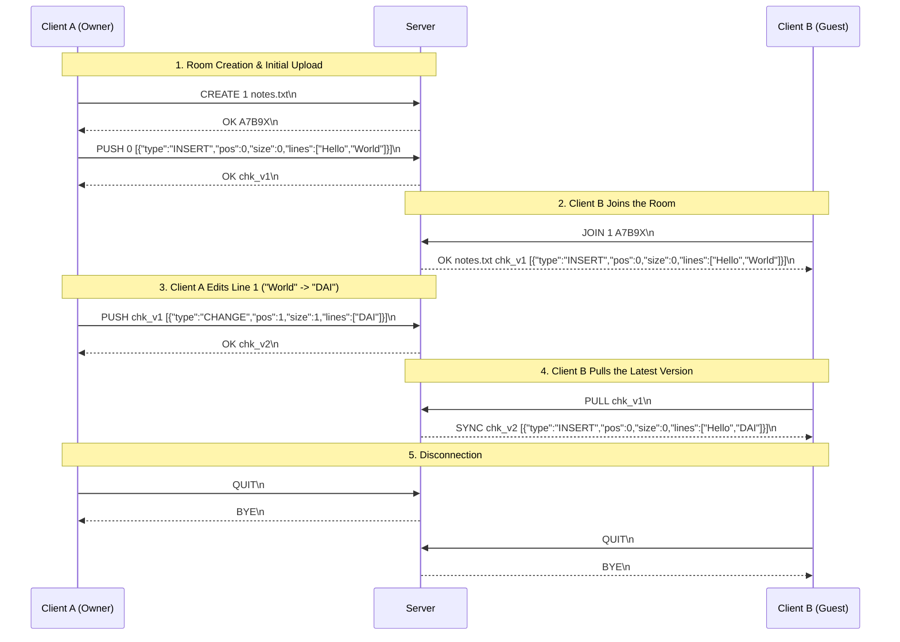
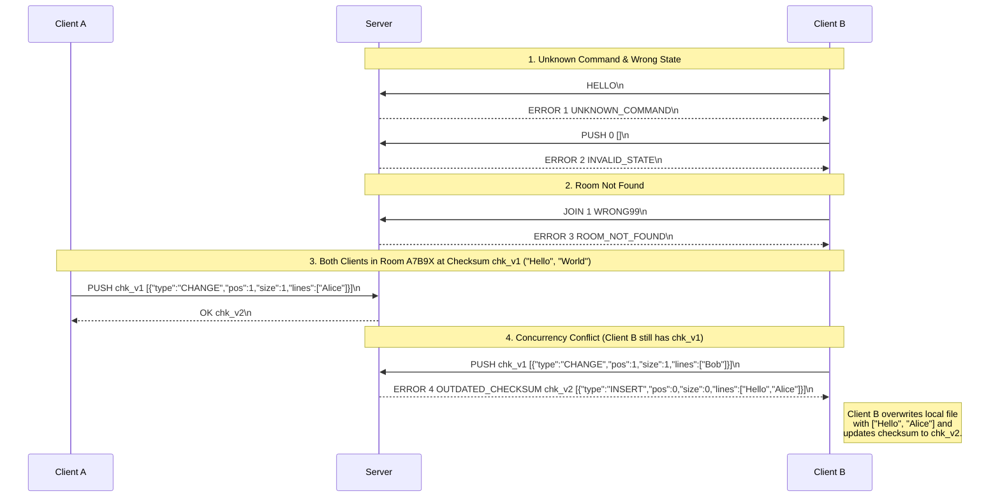

# CDSP - Collaborative Diff Synchronization Protocol (v1)

## Section 1: Overview

The **Collaborative Diff Synchronization Protocol (CDSP)** is a text-based application protocol that allows multiple clients to collaboratively edit and synchronize a text file hosted in a virtual room on a central server.

Instead of sending the entire file on every modification, CDSP relies on the diff model of the `java-diff-utils` library (`INSERT`, `DELETE`, `CHANGE`). Integrity and concurrency control are guaranteed through a **SHA-256 checksum** mechanism:
1. A client creates a room for a file (initial server checksum is `"0"`) and pushes the initial content as an `INSERT` delta.
2. Other clients join the room using a unique room code and retrieve the current state of the file.
3. When a client pushes local changes, it includes the checksum of the version it started editing from (`prevChecksum`).
4. If the server's current checksum matches `prevChecksum`, the patch is applied and a new checksum is generated.
5. If another client modified the file in the meantime (`prevChecksum` does not match), the server rejects the patch with an `OUTDATED_CHECKSUM` error and returns the full current state of the document so the client can resynchronize.

---

## Section 2: Transport Protocol

* **Transport Protocol:** TCP
* **Justification:** File synchronization via incremental patches requires strict reliability and ordering. If a single diff packet is lost, duplicated, or arrives out of order, the resulting file becomes corrupted. TCP guarantees reliable, ordered delivery of bytes and naturally handles connection lifecycle (closing the socket notifies the server that the client has left).
* **Default Port:** `4242` (configurable on both server and client via `picocli` CLI options).
* **Encoding:** `UTF-8`.
* **Message Framing (End of Message):** Every message (request or response) is a single line terminated by a Line Feed character `\n` (`0x0A`).
  * The protocol uses a hybrid format: space-separated text tokens for the command header, and a **compact (single-line) JSON array** for the delta payload. Because newlines inside file lines are either separated into elements of the JSON array or escaped (`\n` as `\\n`), an unescaped `\n` unambiguously marks the end of a protocol message.

---

## Section 3: Messages

### 3.1 Delta JSON Payload Structure
Commands that transmit file changes or full file states use a compact JSON array of Delta objects as their last parameter. The source text is omitted to save bandwidth, as `prevChecksum` already validates the source state.

| Field | Type | Description |
| :--- | :--- | :--- |
| `type` | `String` | `"INSERT"`, `"DELETE"`, or `"CHANGE"` (from `java-diff-utils` `DeltaType`). |
| `pos` | `int` | 0-based start line index in the original document (`source.position`). |
| `size` | `int` | Number of lines affected in the original document (`0` for `INSERT`, `N` for `DELETE`/`CHANGE`). |
| `lines` | `String[]` | New lines to insert (`[]` for `DELETE`, `["line1", ...]` for `INSERT`/`CHANGE`). |

**Compact JSON Payload Example:**
```json
[{"type":"CHANGE","pos":2,"size":1,"lines":["Updated line 3"]}]

```

**Full State Representation:**
When the server sends the complete file (on `JOIN`, `PULL`, or `ERROR 4`), it formats the entire document as a single `INSERT` delta at position `0`:

```json
[{"type":"INSERT","pos":0,"size":0,"lines":["Line 1","Line 2"]}]
```

*(If the room has just been created and the file is completely empty with checksum `"0"`, the array is `[]`).*

---

### 3.2 Client-to-Server Commands and Responses

#### 1. `CREATE` — Create a new synchronization room

Creates a new room on the server for a given filename and places the client inside this room. The server initializes the room's document as empty with checksum `"0"`.

* **Syntax:** `CREATE <v> <filename>\n`
* `<v>`: Protocol version (must be `1`).
* `<filename>`: Name of the shared file (no spaces allowed).


* **Responses:**
* `OK <roomCode>\n` — Room successfully created (e.g., `OK A7B9X`).
* `ERROR 2 INVALID_STATE\n` — The client has already created or joined a room in this session.
* `ERROR 5 BAD_ARGUMENTS\n` — Missing parameters or unsupported protocol version.


#### 2. `JOIN` — Join an existing room

Connects the client to an existing room and retrieves the current file metadata and content.

* **Syntax:** `JOIN <v> <roomCode>\n`
* `<v>`: Protocol version (must be `1`).
* `<roomCode>`: The unique code of the room to join.


* **Responses:**
* `OK <filename> <currentChecksum> <jsonFullState>\n` — Successfully joined.
* `ERROR 2 INVALID_STATE\n` — The client is already in a room.
* `ERROR 3 ROOM_NOT_FOUND\n` — No room exists with the specified `<roomCode>`.
* `ERROR 5 BAD_ARGUMENTS\n` — Missing parameters or unsupported protocol version.


#### 3. `PUSH` — Send file modifications (deltas) to the server

Applies a list of deltas to the room's document if `<prevChecksum>` matches the server's current checksum.

* *Note:* Right after `CREATE`, the owner sends the initial file content using `PUSH 0 [{"type":"INSERT","pos":0,"size":0,"lines":[...]}]`.
* **Syntax:** `PUSH <prevChecksum> <jsonDeltas>\n`
* `<prevChecksum>`: The checksum of the document before the client's modifications (`"0"` for initial upload).
* `<jsonDeltas>`: Compact JSON array of Delta objects.


* **Responses:**
* `OK <newChecksum>\n` — Deltas applied successfully; returns the updated SHA-256 checksum.
* `ERROR 2 INVALID_STATE\n` — Sent before `CREATE` or `JOIN`.
* `ERROR 4 OUTDATED_CHECKSUM <validChecksum> <jsonFullState>\n` — `<prevChecksum>` does not match the server's current checksum. The patch is rejected and the server returns its current valid checksum along with the full document state.
* `ERROR 5 BAD_ARGUMENTS\n` — Malformed JSON, invalid line positions/sizes, or missing arguments.


#### 4. `PULL` — Fetch the latest state from the server

Checks if the client's local version is up to date, and downloads the latest state if changes occurred on the server.

* **Syntax:** `PULL <currentChecksum>\n`
* `<currentChecksum>`: The client's current local checksum.


* **Responses:**
* `UP_TO_DATE\n` — `<currentChecksum>` matches the server's checksum; no data is transferred.
* `SYNC <validChecksum> <jsonFullState>\n` — The server has a newer version; returns the latest checksum and full state.
* `ERROR 2 INVALID_STATE\n` — Sent before `CREATE` or `JOIN`.
* `ERROR 5 BAD_ARGUMENTS\n` — Missing `<currentChecksum>` parameter.


#### 5. `LEAVE` — Leave the current room

Removes the client from the current room without closing the TCP connection, allowing the client to `CREATE` or `JOIN` another room.

* **Syntax:** `LEAVE\n`
* **Responses:**
* `OK\n` — Client removed from the room.
* `ERROR 2 INVALID_STATE\n` — The client is not currently in a room.


#### 6. `QUIT` — Close the connection

Terminates the session and closes the TCP connection.

* **Syntax:** `QUIT\n`
* **Responses:**
* `BYE\n` — Server acknowledges and closes the socket.

---

### 3.3 Error Codes Summary

Whenever a request cannot be fulfilled, the server replies with `ERROR <code> <reason> [optional_data]\n`.

| Code | Reason | Trigger Condition |
| --- | --- | --- |
| `1` | `UNKNOWN_COMMAND` | The command keyword is not recognized by the protocol (e.g., `HELLO`). |
| `2` | `INVALID_STATE` | A valid command is sent at the wrong time (e.g., `PUSH` or `PULL` before `JOIN`/`CREATE`, or `JOIN` when already in a room). |
| `3` | `ROOM_NOT_FOUND` | The `<roomCode>` provided in `JOIN` does not exist on the server. |
| `4` | `OUTDATED_CHECKSUM` | Concurrency conflict during `PUSH`: `<prevChecksum>` differs from the server's checksum. Followed by `<validChecksum> <jsonFullState>`. |
| `5` | `BAD_ARGUMENTS` | Missing arguments, unsupported protocol version, unparseable JSON payload, or out-of-bounds diff positions. |

---

## Section 4: Examples

### 4.1 Successful Communication Example

In this scenario:

1. **Client A (Owner)** creates a room for `notes.txt` and pushes the initial 2 lines.
2. **Client B** joins the room and receives the initial file.
3. **Client A** modifies the second line and pushes the diff.
4. **Client B** pulls the update from the server.



---

### 4.2 Unsuccessful / Error Communication Example

This diagram illustrates protocol error handling:

1. Sending an unknown command (`ERROR 1`).
2. Sending a command in the wrong state (`PUSH` before joining a room -> `ERROR 2`).
3. Joining a non-existent room (`ERROR 3`).
4. A **concurrency conflict** (`ERROR 4`): Client A and Client B both start at `chk_v1`. Client A pushes first (server moves to `chk_v2`). Client B tries to push its own change based on `chk_v1`, gets rejected with `ERROR 4 OUTDATED_CHECKSUM`, and receives the server's `chk_v2` full state to resynchronize.

